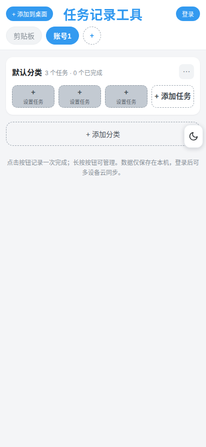
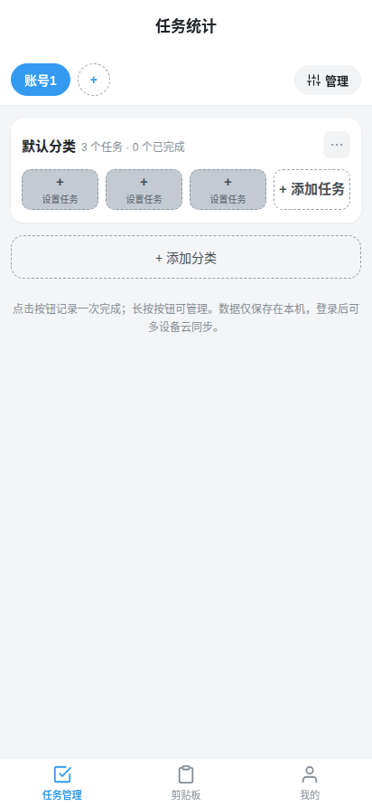
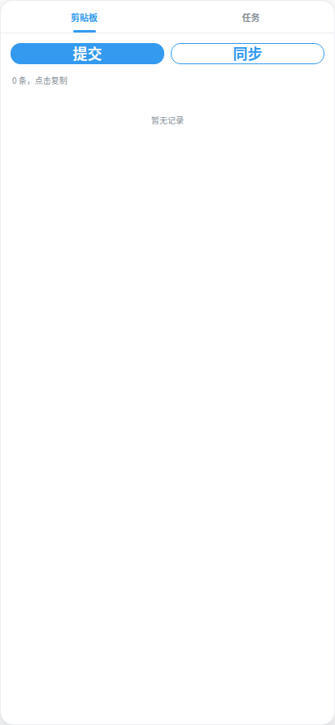

# 任务管理 + 跨设备剪贴板

> 一个网页即可用的轻量工具：**多端任务记录 + 剪贴板实时同步**。
> 安卓 / 鸿蒙有专属 App，iOS / 电脑可「添加到主屏幕」当 App 用。

---

## 一、多端使用

| 端 | 形态 | 说明 |
|----|------|------|
| 网页版 | 任意浏览器打开即用 | 无需安装，扫码即用 |
| App（安卓 / 鸿蒙） | 下载 APK 安装 | 系统闹钟提醒 + 悬浮球快捷入口 |
| 添加到主屏幕 | iOS / 电脑 / 鸿蒙 | 把网页钉成图标，像原生 App |

所有端共享同一账号数据，**实时同步**——在 A 端复制，B 端立刻出现。

## 二、任务记录功能

- 创建任务、分类管理、完成统计一目了然。
- 提醒由 **系统闹钟** 触发：关掉网页 / App 也能响（安卓 / 鸿蒙 App）。
- 网页版提醒需保持页面运行；要完整提醒请装 App。

> 装 App 后，到点由系统闹钟直接提醒，无需保持页面打开、不依赖 Google 推送，国内网络可用。

## 三、跨设备剪贴板同步

- 复制一条，其他设备 **秒级出现**（WebSocket 实时推送 + 轮询兜底）。
- 上限 **200 条**，分页管理，不卡顿。
- 删除采用 **墓碑机制**：多端同步消失，不会再「复活」。
- 悬浮球一键展开，复制即存、点击即填。

## 四、添加到主屏幕（当 App 用）

**iOS（Safari）**
1. 打开网页 → 点底部「分享」按钮
2. 下滑找到「添加到主屏幕」→ 命名后「添加」

**电脑（Chrome / Edge）**
1. 打开网页 → 点右上角 `⋮` 菜单
2. 选「安装应用」或「更多工具 → 创建快捷方式（打开为窗口）」

**鸿蒙 / 安卓浏览器**
- 浏览器菜单 → 「添加到主屏幕」即可。

---

## 下载与在线使用

- 安卓 / 鸿蒙 App：<https://doctorstrange1122.github.io/task-record-tool/task.apk>
- 加速下载（jsDelivr）：<https://cdn.jsdelivr.net/gh/doctorstrange1122/task-record-tool@main/task.apk>
- 网页版：直接用浏览器访问仓库 Pages 地址即可。

> 提示：iOS / 电脑添加的是「网页版」入口；要系统闹钟提醒与悬浮球，请安装安卓 / 鸿蒙 App。
